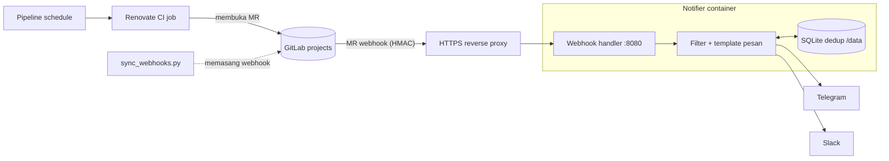

# renovate-runner

Menjalankan [Renovate](https://docs.renovatebot.com/) untuk banyak repository di **GitLab, GitHub, atau Bitbucket Cloud**, dan mengirim notifikasi Telegram/Slack ketika Renovate membuat MR/PR **security** (vulnerability OSV dengan severity MEDIUM ke atas).

[English](README.md) · Lisensi MIT. **Dokumen utama adalah README.md (English)**; berkas ini ringkasan versi Indonesia dan fokus ke GitLab. Untuk setup GitHub/Bitbucket, variabel baru (`RENOVATE_PLATFORM`, `RENOVATE_AUTHOR`, `WEBHOOK_SECRET`, `NOTIFY_LANG`), dan webhook-nya, baca README.md.

Catatan perubahan untuk deployment lama: nama lama `RENOVATE_AUTHOR_ID` dan `GITLAB_WEBHOOK_SECRET` tetap bekerja, tetapi **bahasa pesan default sekarang `en`**. Tambahkan `NOTIFY_LANG=id` di `.env` agar pesan tetap berbahasa Indonesia.

Repo ini berisi dua bagian yang **berjalan terpisah**:

| Bagian | Fungsi | Berjalan sebagai |
|---|---|---|
| **Renovate** (`config.js`, `.gitlab-ci.yml`) | Mendeteksi dependency usang/rentan dan membuat MR | Job GitLab CI, hanya di *scheduled pipeline* |
| **Notifier** (`cmd/`, `internal/`) | Menerima webhook MR/PR dan mengirim notifikasi | Service HTTP yang selalu hidup (Docker) |

Notifier **tidak** dijalankan oleh pipeline. Ia bereaksi terhadap webhook GitLab, jadi notifikasi terkirim beberapa detik setelah MR dibuat, tidak menunggu jadwal berikutnya.

## Arsitektur



Diagram interaktif dengan referensi kode ada di [docs/architecture.html](docs/architecture.html) (buka di browser; dibuat dengan Archify).

## Perilaku notifikasi

Sebuah event diproses hanya kalau **semua** syarat ini terpenuhi:

1. Request lolos verifikasi: signature Standard Webhooks (toleransi 300 detik) atau token GitLab lama.
2. Header `X-Gitlab-Event: Merge Request Hook`.
3. `author_id` MR sama dengan `RENOVATE_AUTHOR_ID` (user bot Renovate).
4. MR menuju *default branch* project.
5. Aksi `open`. Aksi `reopen` **diabaikan**, kecuali MR itu dipilih lewat `REOPEN_TEST_MR` (untuk simulasi).
6. Deskripsi MR memuat severity OSV `MEDIUM`, `MODERATE`, `HIGH`, atau `CRITICAL` (diambil yang tertinggi). MR update biasa tanpa vulnerability **tidak** dikirim.

Event yang tidak memenuhi syarat dibalas `200` tanpa log, jadi "tidak ada notifikasi" tidak selalu berarti error.

Dedup disimpan di SQLite per MR **per channel**. Kalau Telegram sukses tapi Slack gagal, notifier membalas `503`, GitLab mengirim ulang, dan hanya Slack yang diulang.

Format pesan ada di [`internal/notify/message.id.tmpl`](internal/notify/message.id.tmpl). Contoh:

```
🚨 Security · HIGH
lodash 4.17.20 → 4.17.21
CVE-2021-23337 / GHSA-35jh-r3h4-6jhm — Command Injection in lodash

Repo: frontend/dashboard
MR: !588 → development
https://gitlab.example.com/frontend/dashboard/-/merge_requests/588
```

Nama paket dan versi dibaca dari tabel di deskripsi MR. Kalau tabel tidak terbaca, baris itu diganti judul MR, jadi notifikasi tidak hilang.

## Konfigurasi

Semua konfigurasi lewat environment variable. Template ada di [`env.example`](env.example): salin ke `.env`. **Jangan commit `.env`.**

### Notifier (`.env`, dibaca container)

| Variabel | Wajib | Keterangan |
|---|---|---|
| `RENOVATE_AUTHOR_ID` | ya | ID user GitLab pemilik `RENOVATE_TOKEN`. Cari lewat `GET /api/v4/user` dengan token bot. |
| `GITLAB_WEBHOOK_SECRET` | satu dari dua | Secret token webhook (GitLab tanpa signing token, mis. CE 15.11). `openssl rand -hex 32`. |
| `GITLAB_WEBHOOK_SIGNING_TOKEN` | satu dari dua | Signing token `whsec_...` (GitLab 19.1+). Jangan isi bersamaan dengan secret. |
| `TELEGRAM_BOT_TOKEN`, `TELEGRAM_CHAT_ID` | salah satu channel | Harus berpasangan. |
| `TELEGRAM_MESSAGE_THREAD_ID` | tidak | ID topic untuk forum group. |
| `SLACK_WEBHOOK_URL` | salah satu channel | Incoming webhook, wajib `https://`. |
| `REOPEN_TEST_MR` | tidak | `project_id:iid`. Mengaktifkan notifikasi reopen untuk satu MR (simulasi). Kosongkan di produksi. |

Minimal satu channel (Telegram dan/atau Slack) harus aktif, kalau tidak notifier berhenti saat start.

### Renovate dan sync webhook (CI/CD variables, **bukan** `.env` notifier)

| Variabel | Dipakai oleh | Keterangan |
|---|---|---|
| `RENOVATE_TOKEN` | Renovate | Token GitLab bot Renovate. Variabel standar Renovate. |
| `RENOVATE_TARGET_REPOSITORIES` | `config.js`, `sync_webhooks.py` | **Nama group** GitLab dipisah koma, mis. `frontend,backend`. Semua project aktif di group itu (termasuk subgroup) ikut. |
| `RENOVATE_TEST_REPOSITORY` | keduanya | Mode test: satu project `group/project`. Jika terisi, `RENOVATE_TARGET_REPOSITORIES` diabaikan. **Kosongkan untuk go live.** |
| `CI_API_V4_URL` | keduanya | Terisi otomatis di GitLab CI. Untuk script manual: `https://gitlab.example.com/api/v4`. |
| `GITLAB_WEBHOOK_ADMIN_TOKEN` | `sync_webhooks.py` | Token dengan Maintainer di semua project target. **Jangan taruh di `.env` notifier.** |
| `NOTIFIER_WEBHOOK_URL` | `sync_webhooks.py` | URL publik HTTPS yang diakhiri `/webhook`. |

## Deploy notifier

Prasyarat: Docker + Compose, dan server yang bisa dijangkau GitLab lewat HTTPS.

```bash
cp env.example .env        # lalu isi nilainya, tanpa tanda kutip
docker compose up -d --build
curl http://127.0.0.1:8080/healthz    # harus membalas "ok"
```

Catatan deploy:

- Port `8080` hanya di-bind ke `127.0.0.1`. Pasang reverse proxy HTTPS di depannya, contoh di [`nginx.conf.example`](nginx.conf.example) (hanya `/webhook` dan `/healthz`, body maksimum 1 MB).
- Container berjalan **read-only** sebagai UID `65532`. Satu-satunya lokasi tulis adalah volume `notifier-data` di `/data`, tempat `notified.sqlite3` dibuat otomatis.
- **Volume harus persisten.** Kalau hilang, riwayat dedup hilang: retry atau redelivery webhook setelahnya bisa mengirim notifikasi dobel.
- `docker run --env-file` tidak menghapus tanda kutip dan komentar di akhir baris. Tulis `KEY=value` polos, komentar di baris sendiri. Compose menanganinya, tapi tetap pakai nilai polos.
- Notifier dibuat dari `Dockerfile` (multi-stage, image akhir distroless, sekitar 14 MB).

### Update versi

```bash
git pull
docker compose up -d --build
```

Container diganti dalam beberapa detik, volume tetap utuh. Webhook yang datang tepat di jeda itu bisa gagal. Perubahan `config.js` **tidak** butuh deploy ulang karena Renovate membacanya dari repo saat job jalan.

## Setup GitLab

1. **Bot Renovate.** Buat user bot, beri akses Developer/Maintainer ke group target, buat token, simpan sebagai `RENOVATE_TOKEN`. ID user ini menjadi `RENOVATE_AUTHOR_ID`.
2. **Renovate.** Di project ini: Settings → CI/CD → Variables, isi `RENOVATE_TOKEN` dan `RENOVATE_TARGET_REPOSITORIES` (atau `RENOVATE_TEST_REPOSITORY` saat uji coba). Buat jadwal di Build → Pipeline schedules. Job `renovate` hanya jalan untuk `schedule`, jadi tombol *Run pipeline* biasa tidak menjalankannya; pakai tombol Play di halaman schedule.
3. **Webhook.** Pasang webhook MR di tiap project target:
   ```bash
   export CI_API_V4_URL=https://gitlab.example.com/api/v4
   export GITLAB_WEBHOOK_ADMIN_TOKEN=...
   export NOTIFIER_WEBHOOK_URL=https://notify.example.com/webhook
   export GITLAB_WEBHOOK_SECRET=...            # sama dengan di .env notifier
   export RENOVATE_TARGET_REPOSITORIES=frontend,backend
   python3 scripts/sync_webhooks.py
   ```
   Script mengambil semua project aktif di group (archived dilewati), lalu membuat atau memperbarui hook ber-URL yang sama (tidak menghapus hook lain). **Jalankan ulang setiap ada project baru di group**, kalau tidak MR dari project itu tidak memicu notifikasi. Script ini hanya mendukung `GITLAB_WEBHOOK_SECRET`, bukan signing token.

### Rollout: satu repo dulu, baru group

1. Isi `RENOVATE_TEST_REPOSITORY=group/project` (di CI/CD variables **dan** shell untuk `sync_webhooks.py`).
2. Jalankan schedule (opsional dengan `RENOVATE_DRY_RUN=full` dan `LOG_LEVEL=debug` untuk melihat rencana tanpa membuat MR) dan periksa MR serta notifikasinya.
3. Go live: kosongkan `RENOVATE_TEST_REPOSITORY`, isi `RENOVATE_TARGET_REPOSITORIES`, jalankan ulang `sync_webhooks.py`.

## Verifikasi dan simulasi

```bash
python3 scripts/smoke_test.py --send
```

Mengirim webhook MR security palsu (project fiktif `999999999`) ke notifier di `127.0.0.1:8080` dan **benar-benar mengirim pesan** ke channel yang aktif. Skrip memeriksa: `/healthz` = 200, credential salah = 401, MR valid = 200, kirim ulang = 200 tanpa pesan kedua. Cek bahwa hanya satu pesan untuk repo `local-test/renovate-notifier` yang masuk. Opsi `--env <file>` dan `--url <base>` tersedia.

## Troubleshooting

| Gejala | Penyebab umum | Cek |
|---|---|---|
| Notifier berhenti saat start | Env tidak lengkap: `RENOVATE_AUTHOR_ID`, credential webhook, atau channel | Pesan di `docker compose logs` menyebut variabel yang kurang |
| Tidak ada notifikasi, GitLab menampilkan 200 | Event disaring: bukan MR bot, bukan default branch, tanpa severity OSV, atau `reopen` | Lihat syarat di "Perilaku notifikasi" |
| GitLab menampilkan 401 | Secret atau signing token tidak cocok; untuk signing token, jam server selisih lebih dari 300 detik juga ditolak | Samakan secret di GitLab dan `.env`, cek NTP |
| GitLab menampilkan 503 | Pengiriman ke Telegram/Slack gagal; GitLab akan mengulang | `docker compose logs` mencari `delivery failed` (bot belum masuk chat, chat id salah, dst.) |
| GitLab menampilkan 413 | Body kosong atau lebih dari 1 MB | Batas proxy `client_max_body_size` |
| Renovate tidak jalan | Job hanya untuk `schedule` | Jalankan lewat Play di Pipeline schedules |
| Renovate melewatkan project | Token bot tidak punya akses ke project itu | Beri akses bot ke group |
| Notifikasi dobel | Volume `/data` hilang atau tidak persisten | Pastikan volume `notifier-data` tetap ada |

Log tidak memuat token Telegram atau URL webhook Slack: URL dibuang dari pesan error.

## Development

Go 1.25+.

```bash
go run ./cmd/notifier            # membaca .env di folder kerja; env asli menang atas isi file
go vet ./... && go test -race ./...
python3 -I -m unittest discover -s scripts -p 'test_*.py'
```

Notifier membuat `notified.sqlite3` di folder kerja (di Docker: `/data`). Jalankan dari root repo supaya `.env` dan database terbaca di tempat yang benar.

```
cmd/notifier/       entry point
internal/config/    env, loader .env
internal/platform/  verifikasi signature, filter MR/PR (GitLab, GitHub, Bitbucket), parser deskripsi Renovate
internal/notify/    template pesan, Telegram, Slack
internal/store/     SQLite dan dedup
internal/server/    handler HTTP
scripts/            sync_webhooks.py, smoke_test.py
config.js           konfigurasi global Renovate
```

## Batasan yang perlu diketahui

- Hanya vulnerability OSV yang memicu notifikasi. Tingkat *merge confidence* Renovate tidak dipakai karena badge-nya berupa gambar dan datanya butuh token Mend.
- Satu MR dengan beberapa vulnerability menampilkan advisory dengan severity tertinggi.
- Alur lengkap dengan GitLab dan bot Telegram/Slack asli belum diuji dari repo ini. Yang sudah diuji: unit test, simulasi webhook ke container Docker dengan Telegram palsu, dan build image.
