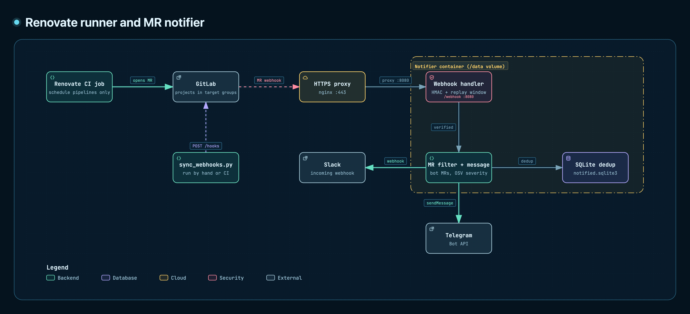

# renovate-runner

Run [Renovate](https://docs.renovatebot.com/) across many repositories on **GitLab, GitHub or Bitbucket Cloud**, and get a Telegram and/or Slack message the moment Renovate opens a **security** merge/pull request (OSV vulnerability, severity MEDIUM or higher).

[Bahasa Indonesia](README.id.md) · [License: MIT](LICENSE) · [Contributing](CONTRIBUTING.md) · [Security](SECURITY.md)

Two independent parts:

| Part                                 | What it does                                             | Runs as                                                                                             |
| ------------------------------------ | -------------------------------------------------------- | --------------------------------------------------------------------------------------------------- |
| **Renovate** (`config.js`, CI files) | Finds outdated/vulnerable dependencies and opens MRs/PRs | A scheduled CI job: `.gitlab-ci.yml`, `.github/workflows/renovate.yml` or `bitbucket-pipelines.yml` |
| **Notifier** (`cmd/`, `internal/`)   | Receives MR/PR webhooks and sends notifications          | An always-on HTTP service (Docker)                                                                  |

The notifier is not started by the pipeline. It reacts to webhooks, so a message arrives seconds after the MR/PR is created.



Interactive version: [`klik`](https://renovate-runner.pages.dev) (search nodes, trace routes, export).

|                                  | GitLab                        | GitHub                     | Bitbucket Cloud        |
| -------------------------------- | ----------------------------- | -------------------------- | ---------------------- |
| Webhook auth                     | secret token or signing token | HMAC `X-Hub-Signature-256` | HMAC `X-Hub-Signature` |
| Reopen simulation                | yes                           | yes                        | no (cannot reopen)     |
| Webhook install                  | `scripts/sync_webhooks.py`    | one organization webhook   | one workspace webhook  |
| Bot identity (`RENOVATE_AUTHOR`) | numeric user ID               | login                      | `account_id` or `uuid` |

Bitbucket Data Center/Server is not supported (different headers and payloads).

> **Status.** GitLab is tested end to end in simulation. For the others, no live webhook has been sent yet; what was checked against primary sources:
>
> | Checked                              | GitHub                                                                                                                             | Bitbucket Cloud                                                                                                                           |
> | ------------------------------------ | ---------------------------------------------------------------------------------------------------------------------------------- | ----------------------------------------------------------------------------------------------------------------------------------------- |
> | Signature header, format, algorithm  | docs                                                                                                                               | docs (plus the documented test vector, in a unit test)                                                                                    |
> | Payload fields the parser reads      | a real sample payload from `octokit/webhooks` (used as a test fixture)                                                             | partly: the REST schema and a third-party sample; `author.uuid` is the reliable ID, `repository.mainbranch` is not documented in webhooks |
> | Renovate PR description still parses | yes: the OSV body is platform-independent, and the GitHub/Bitbucket link and `<details>` rewriting was replayed through the parser | yes (same replay; Bitbucket turns `<details>` into `**More information**`)                                                                |
> | Retries                              | none automatic (docs), 10 s timeout                                                                                                | retried twice, 10 s timeout (third-party source)                                                                                          |
>
> Please report any mismatch you see on a real delivery.

## How notification is decided

An event notifies only if **all** of these hold:

1. The request passes authentication for the platform.
2. It is a PR/MR event (`X-Gitlab-Event: Merge Request Hook`, `X-GitHub-Event: pull_request`, `X-Event-Key: pullrequest:created`).
3. The author is `RENOVATE_AUTHOR`.
4. The target is the repository's default branch (Bitbucket: checked only when the payload carries `repository.mainbranch`).
5. Action is open. Reopen is ignored unless that MR/PR is selected with `REOPEN_TEST_MR`.
6. The description contains an OSV severity of MEDIUM/MODERATE/HIGH/CRITICAL (the highest is used). Plain updates do not notify.

Ignored events get `200` with no log. Bad credentials get `401`, malformed JSON `400`, oversized body `413`, and a failed channel `503` (GitLab retries; Bitbucket retries twice; GitHub does not retry automatically, use "Redeliver"). GitHub and Bitbucket give up after 10 s, so keep Telegram/Slack reachable.

Deduplication is stored in SQLite per MR/PR **per channel**, so a retry repeats only the channel that failed.

Example message (`NOTIFY_LANG=en`; template in [`internal/notify/message.en.tmpl`](internal/notify/message.en.tmpl)):

```
🚨 Security · HIGH
lodash 4.17.20 → 4.17.21
CVE-2021-23337 / GHSA-35jh-r3h4-6jhm — Command Injection in lodash

Repo: frontend/dashboard
PR: #588 → main
https://github.com/frontend/dashboard/pull/588
```

Package and version come from the table in the description; if it is unreadable the title is shown instead.

## Configuration

Copy [`env.example`](env.example) to `.env` (never commit it). Values are plain `KEY=value`, no quotes.

### Notifier (`.env`)

| Variable                                 | Required    | Description                                                                                   |
| ---------------------------------------- | ----------- | --------------------------------------------------------------------------------------------- |
| `RENOVATE_PLATFORM`                      | no          | `gitlab` (default), `github`, `bitbucket`. Renovate reads the same variable.                  |
| `RENOVATE_AUTHOR`                        | yes         | Renovate bot identity (see table above).           |
| `WEBHOOK_SECRET`                         | one of two  | Shared webhook secret (`openssl rand -hex 32`). |
| `GITLAB_WEBHOOK_SIGNING_TOKEN`           | one of two  | GitLab 19.1+ `whsec_...` token. GitLab only; not together with the secret.                    |
| `TELEGRAM_BOT_TOKEN`, `TELEGRAM_CHAT_ID` | one channel | Both or neither.                                                                              |
| `TELEGRAM_MESSAGE_THREAD_ID`             | no          | Forum topic ID.                                                                               |
| `SLACK_WEBHOOK_URL`                      | one channel | Incoming webhook, `https://` only.                                                            |
| `NOTIFY_LANG`                            | no          | `en` (default) or `id`.                                                                       |
| `REOPEN_TEST_MR`                         | no          | `repo_id:iid`; simulate a reopen for one MR/PR. Leave empty in production.                    |

At least one channel must be enabled or the notifier exits at start.

### Renovate (CI variables, **not** the notifier `.env`)

| Variable                                 | Description                                                                                                                                                                                                               |
| ---------------------------------------- | ------------------------------------------------------------------------------------------------------------------------------------------------------------------------------------------------------------------------- |
| `RENOVATE_PLATFORM`                      | Same as above.                                                                                                                                                                                                            |
| `RENOVATE_TOKEN`                         | Renovate token (GitLab, GitHub).                                                                                                                                                                                          |
| `RENOVATE_USERNAME`, `RENOVATE_PASSWORD` | Bitbucket Cloud: the Renovate account's Atlassian email and an API token with repository, pull request, user and workspace read/write scopes ([Renovate docs](https://docs.renovatebot.com/modules/platform/bitbucket/)). |
| `RENOVATE_TARGET_REPOSITORIES`           | GitLab groups, GitHub orgs/users, or Bitbucket workspaces, comma-separated. Every repository inside runs.                                                                                                                 |
| `RENOVATE_TEST_REPOSITORY`               | Test mode: one `owner/repo`; overrides the list. Empty to go live.                                                                                                                                                        |
| `RENOVATE_ENDPOINT`                      | Self-hosted GitHub Enterprise / custom API URL. GitLab CI sets `CI_API_V4_URL` automatically.                                                                                                                             |

GitHub and Bitbucket discovery uses `autodiscoverFilter` (`org/*`) because Renovate documents `autodiscoverNamespaces` only for GitLab, Gitea and Forgejo. The filter lists all repositories the token can see and then filters, so use a token scoped to what you need.

## Deploy the notifier

Needs Docker + Compose and a server reachable over HTTPS from your platform.

```bash
cp env.example .env        # fill it in
docker compose up -d --build
curl http://127.0.0.1:8080/healthz    # prints "ok"
```

- Port 8080 binds to `127.0.0.1`; put an HTTPS reverse proxy in front ([`nginx.conf.example`](nginx.conf.example): only `/webhook` and `/healthz`, 1 MB body limit).
- The container is read-only, runs as UID 65532 and writes only to the `/data` volume (`notified.sqlite3`). **Keep the volume persistent**, or retries can notify twice.
- Update: `git pull && docker compose up -d --build`. Changes to `config.js` need no redeploy.

## Platform setup

### GitLab

1. Create a bot user with Developer/Maintainer on the target groups; its token is `RENOVATE_TOKEN`, its numeric ID is `RENOVATE_AUTHOR`.
2. In CI/CD → Variables set `RENOVATE_TOKEN` and `RENOVATE_TARGET_REPOSITORIES` (or `RENOVATE_TEST_REPOSITORY`). Add a pipeline schedule; the `renovate` job runs only for schedules (use Play on the schedule).
3. Install MR webhooks: set `CI_API_V4_URL`, `GITLAB_WEBHOOK_ADMIN_TOKEN`, `NOTIFIER_WEBHOOK_URL` (public URL ending in `/webhook`), `WEBHOOK_SECRET`, `RENOVATE_TARGET_REPOSITORIES`, then `python3 scripts/sync_webhooks.py`. Re-run it when a project is added. It only supports the secret token, not the signing token.

### GitHub

1. Use a bot user (PAT) or your Renovate GitHub App. `RENOVATE_AUTHOR` is the login that authors the PRs, e.g. `renovate[bot]`.
2. Copy this repo to GitHub. Actions secret `RENOVATE_TOKEN`; variables `RENOVATE_TARGET_REPOSITORIES` or `RENOVATE_TEST_REPOSITORY`. The workflow [`renovate.yml`](.github/workflows/renovate.yml) runs on a schedule and manually.
3. Webhook: Organization (or repository) Settings → Webhooks → Add. Payload URL `https://notify.example.com/webhook`, **Content type `application/json`**, Secret = `WEBHOOK_SECRET`, event **Pull requests** only. A single organization webhook covers every repository, new ones included.

### Bitbucket Cloud

1. Create a bot account and an API token with the scopes in the [Renovate Bitbucket docs](https://docs.renovatebot.com/modules/platform/bitbucket/) (the Renovate account also needs a user group with "Create repositories"). `RENOVATE_AUTHOR` is its `uuid` including braces (`GET https://api.bitbucket.org/2.0/user`) or its `account_id`. Note the Bitbucket Dependency Dashboard does not work because Bitbucket removed issues.
2. Host this repo on Bitbucket; set the variables listed in [`bitbucket-pipelines.yml`](bitbucket-pipelines.yml) and add a schedule for the custom pipeline `renovate`.
3. Webhook: Workspace settings → Webhooks (or per repository) → Add. URL ending in `/webhook`, Secret = `WEBHOOK_SECRET`, trigger **Pull Request → Created**.

The Renovate runner can live on a different platform from the repositories it updates (set `RENOVATE_PLATFORM` and a token for the target platform).

### Rollout: one repository first

1. Set `RENOVATE_TEST_REPOSITORY=owner/repo` (optionally `RENOVATE_DRY_RUN=full`, `LOG_LEVEL=debug`) and run the job.
2. Check the MR/PR and the notification.
3. Go live: clear `RENOVATE_TEST_REPOSITORY`, set `RENOVATE_TARGET_REPOSITORIES`.

## Verify

```bash
python3 scripts/smoke_test.py --send
```

Sends a fake **GitLab** security MR to `127.0.0.1:8080` and really delivers a message to the enabled channels. Checks `/healthz`, bad credential = 401, valid = 200, repeat = 200 without a second message. (GitHub/Bitbucket are covered by Go tests only.)

## Troubleshooting

| Symptom                             | Likely cause                                                                                                              |
| ----------------------------------- | ------------------------------------------------------------------------------------------------------------------------- |
| Notifier exits at start             | Missing `RENOVATE_AUTHOR`, webhook credential or channel; the log names it                                                |
| No notification, platform shows 200 | Filtered: not the bot, not default branch, no OSV severity, or reopen                                                     |
| 401                                 | Secret mismatch. GitHub: content type must be `application/json`. GitLab signing token: clock skew over 300 s is rejected |
| 503                                 | Telegram/Slack delivery failed; see `delivery failed` in the logs                                                         |
| 413                                 | Empty body or over 1 MB; check proxy `client_max_body_size`                                                               |
| Renovate does not run               | GitLab: job is schedule-only. GitHub/Bitbucket: check the schedule                                                        |
| Renovate skips repositories         | Token has no access to them                                                                                               |
| Duplicate notifications             | `/data` volume lost                                                                                                       |
| GitHub/Bitbucket body not parsed    | Message falls back to the title; open an issue with a sample description                                                  |

Logs never include the Telegram token or Slack URL.

## Development

Go 1.25+.

```bash
go run ./cmd/notifier            # reads .env from the working directory; real env wins
go vet ./... && go test -race ./...
python3 -I -m unittest discover -s scripts -p 'test_*.py'
```

```
cmd/notifier/       entry point
internal/config/    env and .env loader
internal/platform/  webhook auth, MR filters and Renovate description parser (GitLab, GitHub, Bitbucket)
internal/notify/    message templates, Telegram, Slack
internal/store/     SQLite dedup
internal/server/    HTTP handler
scripts/            sync_webhooks.py (GitLab), smoke_test.py
config.js           global Renovate config
```

## Limitations

- Only OSV vulnerabilities notify; Renovate's merge-confidence data is not used.
- A MR/PR with several vulnerabilities shows the most severe advisory.
- GitHub also has its own Dependabot-alert PRs; this project relies on `osvVulnerabilityAlerts`, whose description format is the one the parser reads.
- `scripts/` helpers target GitLab only.
