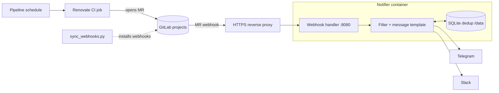

# renovate-runner

Run [Renovate](https://docs.renovatebot.com/) across many GitLab projects, and get a Telegram and/or Slack message the moment Renovate opens a **security** merge request (an OSV vulnerability with severity MEDIUM or higher).

It is two independent parts:

| Part | What it does | Runs as |
|---|---|---|
| **Renovate** (`config.js`, `.gitlab-ci.yml`) | Finds outdated or vulnerable dependencies (Node.js, PHP, Go, Python, ...) and opens MRs | A GitLab CI job, only in scheduled pipelines |
| **Notifier** (`cmd/`, `internal/`) | Receives GitLab MR webhooks and sends the notification | An always-on HTTP service (Docker) |

The notifier is not started by the pipeline. It reacts to GitLab webhooks, so a message arrives seconds after the MR is created instead of waiting for the next schedule.

> **Status.** The notifier is covered by unit tests and was exercised in simulation (fake webhook against the Docker container with a fake Telegram API). A full run against a real GitLab instance and real Telegram/Slack bots has not been done from this repository. Please report anything that behaves differently.

## How it works



An event notifies only if **all** of these hold:

1. The request is authenticated: a Standard Webhooks signature (300 s tolerance) or the legacy GitLab secret token.
2. The header is `X-Gitlab-Event: Merge Request Hook`.
3. The MR author's ID equals `RENOVATE_AUTHOR_ID` (the Renovate bot user).
4. The MR targets the project's default branch.
5. The action is `open`. `reopen` is ignored unless that MR is selected with `REOPEN_TEST_MR` (for simulation).
6. The description contains an OSV severity of `MEDIUM`, `MODERATE`, `HIGH` or `CRITICAL` (the highest one wins). Plain updates without a vulnerability do not notify.

Events that do not qualify get `200` and no log line, so "no notification" is not always an error. Bad credentials get `401`, malformed JSON `400`, an empty or oversized body `413`, and a failed channel `503` so GitLab retries.

Deduplication lives in SQLite, per MR **per channel**. If Telegram succeeds and Slack fails, the notifier answers `503`, GitLab retries, and only Slack is repeated.

Example message. The text is currently **Indonesian** and lives in [`internal/notify/message.tmpl`](internal/notify/message.tmpl); edit that file to change the wording or language.

```
🚨 Security · HIGH
lodash 4.17.20 → 4.17.21
CVE-2021-23337 / GHSA-35jh-r3h4-6jhm — Command Injection in lodash

Repo: frontend/dashboard
MR: !588 → development
https://gitlab.example.com/frontend/dashboard/-/merge_requests/588
```

Package and version are read from the table in the MR description. If the table cannot be read, the MR title is shown instead, so the notification is never lost.

## Configuration

Everything is configured through environment variables. Copy [`env.example`](env.example) to `.env` and fill it in. **Never commit `.env`.** Write plain `KEY=value`: no quotes, comments on their own line.

### Notifier (`.env`, read by the container)

| Variable | Required | Description |
|---|---|---|
| `RENOVATE_AUTHOR_ID` | yes | GitLab user ID of the Renovate bot (`GET /api/v4/user` with the bot's token). |
| `GITLAB_WEBHOOK_SECRET` | one of two | Secret token of the webhook (works on GitLab without signing tokens, e.g. CE 15.11). `openssl rand -hex 32`. |
| `GITLAB_WEBHOOK_SIGNING_TOKEN` | one of two | Signing token `whsec_...` (GitLab 19.1+). Do not set together with the secret. |
| `TELEGRAM_BOT_TOKEN`, `TELEGRAM_CHAT_ID` | one channel | Both or neither. |
| `TELEGRAM_MESSAGE_THREAD_ID` | no | Forum topic ID. |
| `TELEGRAM_API_BASE` | no | Proxy for the Telegram API. Default `https://api.telegram.org`. |
| `SLACK_WEBHOOK_URL` | one channel | Incoming webhook, `https://` only. |
| `REOPEN_TEST_MR` | no | `project_id:iid`. Enables the reopen notification for one MR (simulation). Leave empty in production. |

At least one channel (Telegram and/or Slack) must be enabled, otherwise the notifier exits at start.

### Renovate and webhook sync (CI/CD variables, **not** the notifier `.env`)

| Variable | Used by | Description |
|---|---|---|
| `RENOVATE_TOKEN` | Renovate | GitLab token of the bot. |
| `RENOVATE_TARGET_REPOSITORIES` | `config.js`, `sync_webhooks.py` | GitLab **group** names, comma-separated, e.g. `frontend,backend`. Every active project in those groups is included, subgroups too (`platform/web`). |
| `RENOVATE_TEST_REPOSITORY` | both | Test mode: a single `group/project`. When set, `RENOVATE_TARGET_REPOSITORIES` is ignored. **Empty it to go live.** |
| `CI_API_V4_URL` | both | Set automatically in GitLab CI. For manual script runs: `https://gitlab.example.com/api/v4`. |
| `GITLAB_WEBHOOK_ADMIN_TOKEN` | `sync_webhooks.py` | Token with Maintainer access to every target project. Keep it out of the notifier `.env`. |
| `NOTIFIER_WEBHOOK_URL` | `sync_webhooks.py` | Public HTTPS URL ending in `/webhook`. |
| `GITHUB_COM_TOKEN` | Renovate | Optional; avoids GitHub rate limits when fetching release notes. |

## Deploy the notifier

Requirements: Docker with Compose, and a server that GitLab can reach over HTTPS.

```bash
cp env.example .env        # then fill in the values
docker compose up -d --build
curl http://127.0.0.1:8080/healthz    # must print "ok"
```

- Port `8080` is bound to `127.0.0.1`. Put an HTTPS reverse proxy in front; see [`nginx.conf.example`](nginx.conf.example) (only `/webhook` and `/healthz`, 1 MB body limit).
- The container runs read-only as UID `65532`. The only writable place is the `notifier-data` volume at `/data`, where `notified.sqlite3` is created.
- **Keep the volume persistent.** If it is lost, the dedup history is lost and a retried webhook can notify twice.
- The image is a multi-stage build on distroless, about 14 MB.

To update:

```bash
git pull
docker compose up -d --build
```

The container is replaced within seconds and the volume is kept. A webhook that arrives in that gap can fail and is retried by GitLab. Changes to `config.js` need no redeploy; Renovate reads it from the repository on every run.

## GitLab setup

1. **Bot.** Create a bot user, give it Developer or Maintainer on the target groups, create a token and store it as `RENOVATE_TOKEN`. The user's ID is `RENOVATE_AUTHOR_ID`.
2. **Renovate.** In this project: Settings → CI/CD → Variables, set `RENOVATE_TOKEN` and `RENOVATE_TARGET_REPOSITORIES` (or `RENOVATE_TEST_REPOSITORY` while testing). Create a schedule under Build → Pipeline schedules. The `renovate` job runs only for `schedule`, so a normal *Run pipeline* does not start it; use the Play button on the schedule.
3. **Webhooks.** Install the MR webhook on every target project:
   ```bash
   export CI_API_V4_URL=https://gitlab.example.com/api/v4
   export GITLAB_WEBHOOK_ADMIN_TOKEN=...
   export NOTIFIER_WEBHOOK_URL=https://notify.example.com/webhook
   export GITLAB_WEBHOOK_SECRET=...            # same value as in the notifier .env
   export RENOVATE_TARGET_REPOSITORIES=frontend,backend
   python3 scripts/sync_webhooks.py
   ```
   The script lists every active project in the groups (archived ones are skipped) and creates or updates the hook with that exact URL. It never deletes other hooks. **Run it again whenever a project is added to a group**, otherwise its MRs do not trigger notifications. It supports `GITLAB_WEBHOOK_SECRET` only, not the signing token. If the notifier is on a local-network address, GitLab must be allowed to send webhooks to the local network (Admin → Settings → Network → Outbound requests).

Renovate itself does not need the script: it creates MRs in every project of the group the bot can access. The script only makes the notifications work.

### Rollout: one project first, then the groups

1. Set `RENOVATE_TEST_REPOSITORY=group/project` (in the CI/CD variables **and** your shell for `sync_webhooks.py`).
2. Run the schedule, optionally with `RENOVATE_DRY_RUN=full` and `LOG_LEVEL=debug` to see the plan without creating MRs, and check the MR and the notification.
3. Go live: empty `RENOVATE_TEST_REPOSITORY`, set `RENOVATE_TARGET_REPOSITORIES`, run `sync_webhooks.py` again.

The first live run can open many MRs at once across all projects, so check the dry-run log first.

## Verify

```bash
python3 scripts/smoke_test.py --send
```

This sends a fake security MR (fictional project `999999999`) to a notifier on `127.0.0.1:8080` and **really delivers a message** to the enabled channels. It checks that `/healthz` is 200, a wrong credential is 401, a valid MR is 200, and a resend is 200 without a second message. Make sure exactly one message for `local-test/renovate-notifier` arrived. Options: `--env <file>`, `--url <base>`.

## Troubleshooting

| Symptom | Likely cause | Check |
|---|---|---|
| Notifier exits at start | Missing `RENOVATE_AUTHOR_ID`, webhook credential or channel | The message in `docker compose logs` names the variable |
| No notification, GitLab shows 200 | Event filtered: not the bot, not the default branch, no OSV severity, or `reopen` | See the conditions above |
| GitLab shows 401 | Secret or signing token mismatch; a signing token also fails if the clocks differ by more than 300 s | Same secret in GitLab and `.env`; check NTP |
| GitLab shows 503 | Delivery to Telegram/Slack failed; GitLab retries | Look for `delivery failed` in the logs (bot not in the chat, wrong chat ID, ...) |
| GitLab shows 413 | Empty body or over 1 MB | Proxy `client_max_body_size` |
| Renovate does not run | The job runs only for `schedule` | Start it with Play on the pipeline schedule |
| Renovate skips a project | The bot has no access to it | Add the bot to the group |
| Duplicate notifications | The `/data` volume is gone or not persistent | Keep the `notifier-data` volume |

Logs never contain the Telegram token or the Slack webhook URL.

## Development

Go 1.25+.

```bash
go run ./cmd/notifier            # reads .env from the working directory; real env wins
go vet ./... && go test -race ./...
python3 -I -m unittest discover -s scripts -p 'test_*.py'
```

The notifier creates `notified.sqlite3` in the working directory (`/data` in Docker). Run it from the repository root so `.env` and the database are found.

```
cmd/notifier/       entry point
internal/config/    environment settings, .env loader
internal/gitlab/    signature check, MR filters, Renovate description parser
internal/notify/    message template, Telegram, Slack
internal/store/     SQLite and dedup
internal/server/    HTTP handler
scripts/            sync_webhooks.py, smoke_test.py
config.js           global Renovate config
```

Contributions are welcome: open an issue or a merge request, keep changes small, and add a test for new logic.

## Limitations

- GitLab only. The notifier and `sync_webhooks.py` do not support GitHub or Bitbucket.
- Only OSV vulnerabilities trigger a notification. Renovate's merge-confidence level is not used: its badge is an image and the data needs a Mend token.
- An MR with several vulnerabilities shows the advisory with the highest severity.
- Message text is Indonesian only, until the template is edited.
